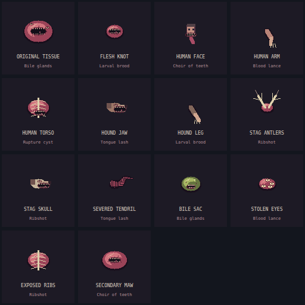

# ORGANISM — No Final Form

**Eat your enemies. Keep their bodies. Turn every organ into a weapon.**

An experimental pixel-art body-horror survival game combining snake-like movement, corpse assimilation, organic weapons, tower defense and run-based mutations. You control a growing colony of stolen flesh: trailing chains split into arms, each part fires its own weapon, and biomass funds both survival and expansion.

**[Play the public prototype](https://organism-the-hungry-garden.cocoachord9.chatgpt.site/?v=4)** · **[Game Design Document](docs/GDD.md)** · **[Vision](docs/vision.md)** · **[Art & audio direction](docs/art-direction.md)**



## Play locally

Requires a current desktop browser, Node.js 22 or newer for tests, and Python 3 for the development server. The game has no npm dependencies or build step.

```sh
git clone https://github.com/aviadr1/organism-no-final-form.git
cd organism-no-final-form
npm start
```

Open **http://localhost:4173** and choose **Become**. Audio unlocks on that click. Serve the files over HTTP; opening `index.html` directly is not supported by the module imports.

```sh
npm test                  # Real simulation tests, no browser required
npm run docs:catalog      # Regenerate abilities reference from game definitions
```

## What you can play now

- Assimilate recognizable human, animal and monstrous organs into a trailing, occasionally branching body.
- Equip each part independently with one of seven organic weapons. All ready organs can fire together; automatic targeting is local to each part.
- Upgrade individual parts through five levels, and choose from sixteen stacking run mutations.
- Choose Sip, Feast or Rupture to trade biomass consumption against firepower.
- Plant colonies and four kinds of living towers; bud orbiting shields and independent hunter drones.
- Explore unbounded coordinates across three procedural biomes, with escalating infection and recurring bosses.
- Hear an original synthesized horror score and wet sound effects, with independent volume controls.

This is a **single-player browser prototype**, not a finished commercial release. Runs are held in memory. Only the best kill count survives a refresh. Visible anatomy is capped at 49 nodes; excess organs fuse into existing tissue. Distant colonies go dormant. See the [current implementation and limits](docs/prototype.md).

## Controls

| Input | Action |
| --- | --- |
| WASD / arrows | Move |
| Mouse + hold click / Space | Aim and fire all ready body weapons |
| F | Toggle automatic targeting |
| B | Open the paused body workshop |
| [ / ] | Select previous / next body part |
| 1–7 | Equip the selected part; other parts keep their weapons |
| U | Upgrade the selected part with biomass |
| Z | Cycle discharge level |
| Q / E | Bud an orbiting shield / independent hunter |
| T / R | Select a tower / root it at your position |
| C / X | Plant a colony / recall nearby mobile offspring |
| Escape | Pause or resume |

Phones have a movement joystick and tap controls. Desktop remains the primary playtest target.

## Design library

| Document | Purpose |
| --- | --- |
| [GDD](docs/GDD.md) | Core loop, anatomy, combat, economy, enemies, colonies, progression and design constraints |
| [Vision](docs/vision.md) | Player fantasy, design pillars and creative references |
| [Abilities](docs/abilities.md) | Generated weapon, anatomy, tower, prey and mutation catalog with current numbers |
| [Art & audio direction](docs/art-direction.md) | Pixel language, anatomy identity, effects, palette and sound direction |
| [Assets](assets/README.md) | Asset inventory, provenance and atlas export instructions |
| [Prototype guide](docs/prototype.md) | Implemented behavior, controls and technical limits |
| [Architecture & publishing](docs/architecture.md) | Module ownership, verification and hosting |
| [Roadmap](docs/roadmap.md) | Proposed milestones and unresolved product decisions |

## Repository layout

`dist/` is the **hand-authored game source and deployable static site**, despite its name. `content.js` owns definitions, `engine.js` owns simulation, `pixel-world.js` owns art, `audio.js` owns sound, and `game.js` connects them to the browser. `tests/` exercises the simulation. `assets/` contains the visual atlas and its exporter; the runtime renders and synthesizes its own assets.

The current hosting identity in `.openai/hosting.json` belongs to this project's existing Sites deployment. Do not reuse its project ID for a fork. Publishing to GitHub does not automatically update the public game; see [publishing](docs/architecture.md#publishing).

## Project status and credits

Created by **aviadr1**, developed with Codex. Creative references include *The Thing*, *Slither*, *Carrion*, and the user's reference to *Pathogenic*, alongside snake growth, survival shooters and tower defense. These are directional references, not imported art, audio, characters or branding. The intended perspective is 2.5D; the current renderer uses a 2D canvas with depth cues.

No third-party artwork, audio recordings, fonts or game libraries are bundled. No distribution license has been selected for this repository yet.
