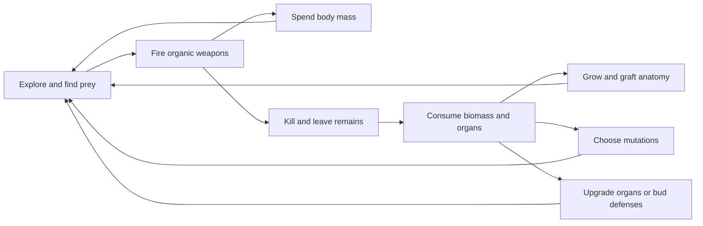

# Game Design Document — ORGANISM: No Final Form

**Baseline:** published browser build 04, October 10, 2026.  
**Owner:** aviadr1.  
**Scope:** current mechanics plus explicitly labeled design direction. Numbers are prototype tuning values. [Abilities](abilities.md) is generated from the canonical definitions in `dist/content.js`; behavior is implemented in `dist/engine.js`.

## 1. Pitch and genre

A pixel-art body-horror survival game where you consume humans, animals and monstrosities, attach their remains to a growing organism, and fire living weapons from every part. Biomass is health, ammunition and construction material. Trailing chains fork into arms while rooted colonies, living towers and mobile offspring turn survival into territorial expansion.

The game combines snake-like control, action survival, tower-defense construction and run-based mutations. It is currently single-player, browser-local and endless, without a campaign, extraction objective or permanent unlock tree.

## 2. Core loop

Moment to moment: steer toward food or away from danger, let the body attack, and manage biomass. Between encounters: inspect parts, equip weapons, upgrade, root a tower or move far enough to plant another colony. Over a run: accumulate a personal anatomy and defense network while infection pressure rises.

There is no victory condition yet. A run ends when body mass falls below 6g. Losing colonies does not itself end the run.

## 3. Player control and camera

Movement uses WASD/arrows or the touch joystick; diagonal input is normalized. Automatic fire is initially enabled. Manual aim and held fire override automatic targeting while held. All ready organs participate; each organ has its own firing origin, range and cooldown.

The camera follows the core through an unbounded coordinate field and modestly zooms out as anatomy grows. The current view is a top-down 2D canvas with floor shadows, height offsets and vertical sorting to suggest 2.5D depth. It is not a 3D simulation, and scenery does not block movement.

The B-key workshop suspends the simulation. Closing it restores the previous playing or paused state. Losing window focus pauses active play. See [controls](prototype.md#play).

## 4. Anatomy and assimilation

The body is a connected tree rooted at the original core. Most joints have one child; occasional joints split into two. New forks originate behind the growing tip so both arms contain meaningful lengths of anatomy. Body links follow turns with constrained separation and lateral tension at fork joints. The player steers the core, not each limb separately.

A corpse drops biomass chunks and one identifiable organ. Consuming ordinary flesh restores mass and grants nutrients. Consuming the organ also creates a graft with its anatomical type, source species, parent joint, default weapon and level-one upgrade state. The same visual part appears on the creature, among its remains and on the player after consumption.

Recognizable anatomy includes human faces, arms and torsos; hound jaws and legs; stag skulls and antlers; bile sacs, eyes, ribs, tendrils and secondary maws. A body part's default weapon reflects its anatomy, but the workshop can equip any of the seven weapon families on any part at no equipment-change cost.

**Current limits:** at most 49 active body nodes. Further organs fuse into existing tissue while mass and species counts continue increasing. Visual size is capped. Body damage subtracts from shared mass; individual limbs do not have separate health, get severed, or disappear when mass is spent. Freely moving attachment points and choosing fork locations are not implemented.

## 5. Distributed combat

Every organ owns a weapon, aim, upgrade level and cooldown. Manual fire asks all ready organs to attack toward the cursor. Automatic fire independently seeks a living enemy within each organ's range. Weapons continue alongside each other; the selected organ is only the one being edited.

A ready organ spends its own shot cost when it actually fires. Lack of a target or affordable mass skips that organ without preventing other organs from firing. Processing priority rotates across volleys. Both upgrades and weapon changes preserve an existing cooldown, preventing instant-fire exploits.

Weapon roles:

- **Bile glands:** corrosive projectiles create slowing, damaging pools.
- **Ribshot:** five bone fragments cover a spread.
- **Larval brood:** paired homing parasites pursue prey.
- **Tongue lash:** a close-range forward cone tears through multiple enemies.
- **Blood lance:** a narrow line pierces multiple targets.
- **Rupture cyst:** a slow explosive tumor leaves a caustic hazard.
- **Choir of teeth:** radial damage and knockback around its emitting organ.

Some effects are instantaneous simulation attacks with animated visual traces; not every visible tongue or blood jet is a physics object. Numbers, projectile behavior and range assumptions are cataloged in [Abilities](abilities.md).

### Discharge modes

All three modes permit every organ to fire. They scale output rather than selecting a subset of mouths.

| Mode | Cost multiplier | Damage multiplier | Cooldown multiplier |
| --- | --- | --- | --- |
| Sip | 0.65 | 0.80 | 1.25 |
| Feast | 1.00 | 1.00 | 1.00 |
| Rupture | 1.35 | 1.30 | 0.78 |

Sip supports survival and feeding. Rupture trades faster expenditure for immediate pressure. The displayed full-body volley cost is an upper comparison value; actual automatic shots depend on cooldowns and nearby targets.

## 6. Biomass economy

The player starts with 100g. Shooting, upgrades, shields, hunters, towers and colonies spend shared mass. Those voluntary expenditures preserve a 12g reserve. Enemy damage can push below that reserve and ultimately kill the organism.

Eating restores mass; digestion mutations increase the return. Nearby colonies provide small periodic pulses of mass and heal offspring. Reabsorbing mobile offspring returns the fraction of their allocated biomass corresponding to surviving health. It does not refund dead offspring or uproot towers.

The economy deliberately couples aggression, durability and expansion. The prototype still needs human playtesting: automated survival runs are useful regression checks, not proof of good pacing or difficulty. Late-run mass snowballing and escalating output remain tuning risks.

## 7. Upgrades and mutations

### Individual organ upgrades

Each organ has five levels. The four upgrades cost 12g, 24g, 36g and 48g. At level `L`, relative to the weapon's base definition:

- Damage: `base × (1 + 0.35 × (L − 1))`.
- Range: `base × (1 + 0.08 × (L − 1))`.
- Shot cost: `base × (1 + 0.08 × (L − 1))`.
- Cooldown: `base ÷ (1 + 0.12 × (L − 1))`.

Global mutations and discharge modifiers apply afterward. Upgrades also slightly enlarge the rendered part, and small marks show its level. Levels belong to the organ and survive re-equipping a different weapon during the same run.

### Run mutations

Eating grants nutrients. At each threshold, action pauses for a choice of three distinct options from the sixteen-mutation pool. Choices stack across the run. The next threshold increases after each selection. Mutations affect offense, speed, attraction radius, defense, digestion, shot efficiency, new anatomy, offspring, colonies or hazards.

There is no permanent mutation currency, saved loadout, unlock progression or meta-progression screen. Restart clears anatomy upgrades, equipment and mutations.

## 8. Colonies, towers and offspring

| System | Current role |
| --- | --- |
| Colony | Persistent rooted support node with health; heals nearby offspring and feeds a nearby player periodically |
| Bile spire | Area denial through corrosive pools |
| Rib harpoon | Long-range piercing defense |
| Brood hive | Ranged homing pressure |
| Rooted maw | Close-range radial damage and displacement |
| Orbiting shield | Tethered tissue rotates around the player and damages enemies by contact |
| Hunter drone | Detached predator picks targets around itself and pursues them independently |

Colonies require at least 220m separation. Towers need an unoccupied nearby root bed. Mobile offspring are limited to 18. Drones return toward the player when no target is available and can be recalled with shields within 700m. The shield tether is visual and its orbit is prescribed; it is not a simulated rope or a general projectile-interception system.

Colonies and towers retain their world positions. Within 1,000m of the player, colonies are active; distant colonies go dormant. There is no always-running offscreen siege simulation. Enemy attacks are opportunistic against nearby body parts, offspring and active colonies; there are no authored tower-defense lanes or enemy pathfinding through mazes yet.

## 9. World and enemies

The world has no fixed arena wall. Deterministic terrain establishes quarantine woods, abandoned works and a meat marsh. Exploration discovers local prey and discarded organs. Revisiting discovered sectors does not repeat the same discovery spawn. Time-driven spawns continue, active entities are bounded and distant enemies/remains are discarded.

Humans include workers and ranged containment officers. Animals include infected hounds and hollow stags. Monstrosities include split torsos, bile carriers, rib cathedrals and the Congregation boss. All currently behave as threats; civilians do not yet flee, organize or surrender.

Infection increases every 45 seconds. Enemy health and pressure grow with stage. Every fourth stage spawns a Congregation when the active enemy budget allows it. There is no stage-six victory cap.

## 10. Presentation and feedback

The creature should be revolting yet understandable. Organs remain identifiable, silhouettes distinguish prey types, and local firing flashes show the distributed arsenal. Weapon colors and level marks support selection. A pale bracket highlights the selected body part.

The interface exposes mass, anatomy count, colonies, infection, location, nutrients, equipped weapon counts, discharge cost, build commands and the part workshop. Radar shows local actors; edge markers point toward recent colonies.

The original procedural score combines low ostinatos, detuned choir-like tones, drones, breathing noise and a heartbeat. Wet transients distinguish several weapon families and reinforce feeding, impacts, budding and damage. Music and effects have separate controls and a master mute. [Art direction](art-direction.md) defines the presentation language and outstanding accessibility work.

## 11. Technical scope and acceptance criteria

The game runs entirely in the browser, without accounts, backend services or runtime dependencies. Its reusable simulation is separate from rendering and input. Current hosting serves static files. See [Architecture](architecture.md).

The prototype should preserve these observable properties:

1. Assimilation keeps the consumed part's identity and default weapon.
2. Changing or upgrading one part never silently rewrites another.
3. All ready, affordable organs can fire during one trigger.
4. Independent cooldowns survive equipment changes.
5. Bodies form connected chains and sparse binary forks with no cycles.
6. Voluntary spending preserves the biomass reserve.
7. Paused workshop operations do not advance the world.
8. Colonies retain their locations; drones hunt independently.
9. Restart clears run-local progression.

Automated simulation tests cover these contracts and existing weapon, colony and movement behavior. Browser checks cover the workshop, control wiring, rendering, mobile layout and audio interaction. Test counts and checks are reproducible via repository commands; broader balancing and usability remain playtest work.

## 12. Future design decisions

The following are **proposals**, not implemented promises: manually directing forks, organ-specific health and severing, automatic or manual reattachment, constrained weapon-anatomy compatibility, specialized drone orders, richer colony objectives, authored world encounters, save/resume, gamepad input, permanent unlocks, co-op or competitive play, and a desktop or Roblox adaptation.

Decide these through playtests against the vision, not by adding all of them at once. [Roadmap](roadmap.md) gives an incremental development sequence.
